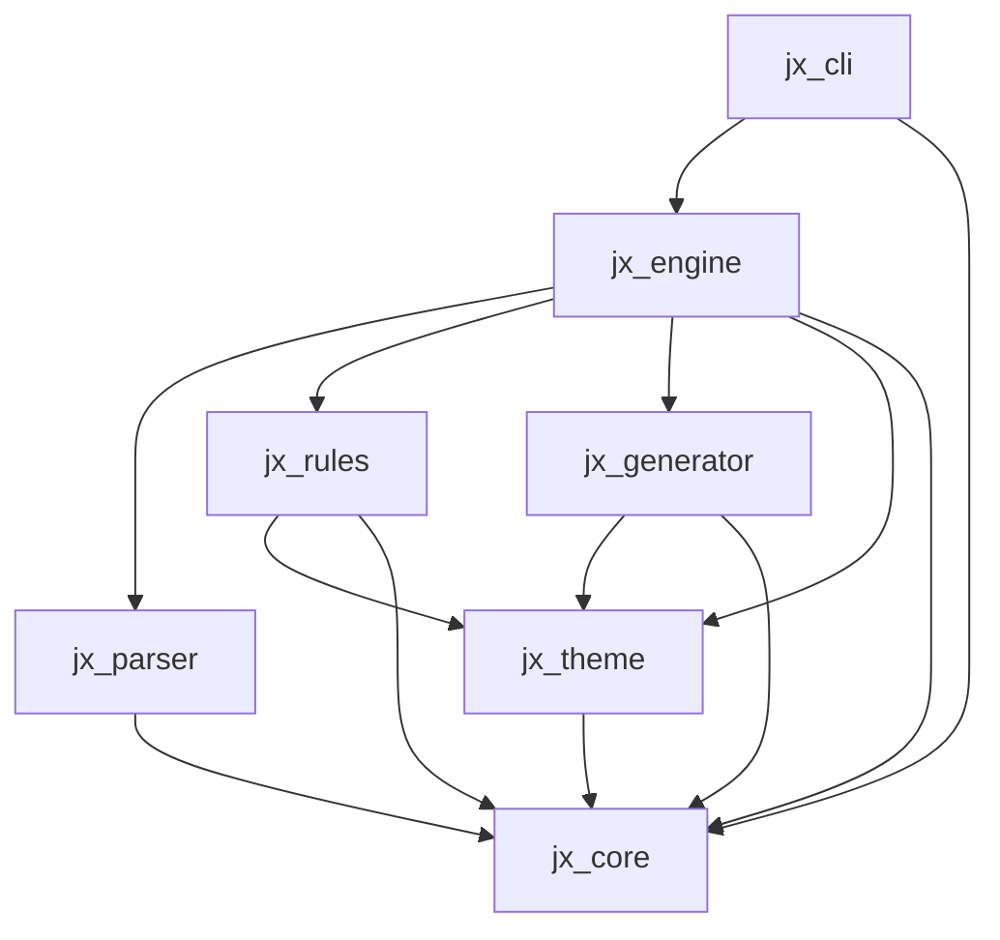

# JX CSS

> Moteur CSS Utility-First propriétaire moderne, haute performance et modulaire, entièrement écrit en Dart.

[](https://dart.dev)
[](https://melos.invertase.dev)
[](LICENSE)

---

## 1. Vision et objectifs

**JX CSS** est un framework CSS Utility-First développé à 100 % en **Dart**, sans dépendance à Node.js ni à Tailwind CSS.

- **Conçu en priorité pour Jaspr** : s'intègre nativement avec les composants Jaspr et l'écosystème web Dart.
- **CSS standard agnostique** : produit des feuilles de style CSS standard compatibles avec le HTML classique, les templates serveur ou tout autre framework web.
- **Syntaxe propriétaire** : syntaxe de classes utility propre (`[variante:]utilitaire[:valeur][!]`), indépendante et prévisible.
- **Zéro runtime JavaScript obligatoire** : compilation en amont (AOT) ou JIT en Dart natif.
- **Extensibilité modulaire** : architecture basée sur des contrats stricts, des plugins, des registres de règles et des thèmes tokenisés.

---

## 2. Architecture du Monorepo

Le projet est structuré sous forme de monorepo géré avec [Melos](https://melos.invertase.dev) dans le dossier `packages/` :

```
zaspr_kit/
├── analysis_options.yaml       # Configuration unifiée de l'analyse statique Dart
├── melos.yaml                  # Configuration de l'espace de travail Melos
├── pubspec.yaml                # Racine de l'espace de travail
├── README.md                   # Présentation générale du projet
├── docs/
│   └── architecture.md         # Documentation architecturale détaillée
└── packages/
    ├── jx_core/                # Modèles, interfaces, erreurs et contrats communs
    ├── jx_theme/               # Tokens, variables CSS et gestion des thèmes
    ├── jx_rules/               # Définition des règles CSS et registre
    ├── jx_parser/              # Analyse et interprétation de la syntaxe des classes
    ├── jx_generator/           # Génération, formatage et sérialisation du CSS
    ├── jx_engine/              # Orchestration du moteur de compilation
    └── jx_cli/                 # Interface en ligne de commande (CLI)
```

### Rôle et responsabilités des packages

| Package | Rôle principal | Dépendances internes |
| :--- | :--- | :--- |
| **`jx_core`** | Modèles fondamentaux (`JxCssRule`, `JxCssDeclaration`, `JxClassToken`), interfaces (`JxParserContract`, `JxThemeContract`, `JxRuleContract`, `JxGeneratorContract`, `JxEngineContract`) et exceptions. | *Aucune* |
| **`jx_theme`** | Définition des tokens (`JxTokenValue`, `JxThemeData`), résolution de thème (`JxTheme`) et génération de variables CSS (`--jx-*`). | `jx_core` |
| **`jx_rules`** | Registre de règles (`JxRuleRegistry`), classe de base `JxRule` et échappement des sélecteurs CSS. | `jx_core`, `jx_theme` |
| **`jx_parser`** | Découpage lexical des chaînes de classes, parsing des variantes, identifiants, valeurs et drapeaux d'importance. | `jx_core` |
| **`jx_generator`** | Formatage du CSS (standard ou minifié), regroupement des `@media` et injection du bloc `:root`. | `jx_core`, `jx_theme` |
| **`jx_engine`** | Orchestrateur du pipeline : Parser -> Rules/Theme -> Generator -> `JxCompileResult`. | `jx_core`, `jx_parser`, `jx_theme`, `jx_rules`, `jx_generator` |
| **`jx_cli`** | Interface en ligne de commande Dart (`bin/jx.dart`) pour la compilation et l'automatisation. | `jx_core`, `jx_engine` |

---

## 3. Dépendances entre packages

Le graphe des dépendances est acyclique (DAG) avec `jx_core` comme socle commun :



---

## 4. Guide de démarrage rapide

### Prérequis

- **Dart SDK** : `>= 3.10.7`
- **Melos** : `^8.10.0` (installable globalement via `dart pub global activate melos`)

### Initialisation du monorepo

```bash
# Résolution et liaison des packages du monorepo
melos bootstrap
```

### Commandes utiles

```bash
# Vérification de l'analyse statique sur tous les packages
melos run analyze

# Exécution de l'ensemble de la suite de tests
melos run test

# Vérification du formatage du code
melos run format

# Formatage automatique
melos run format:fix
```

### Utiliser JX CSS dans un projet

```bash
# Crée un jx.yaml commenté à la racine du projet
dart run jx_cli:jx init

# Scanne lib/ et web/ (fichiers .dart et .html) et écrit build/jx.css
dart run jx_cli:jx build

# Reconstruit automatiquement à chaque modification
dart run jx_cli:jx build --watch

# Compile une expression et affiche le CSS (sans scan ni preflight)
dart run jx_cli:jx build -i "flex p:4 hover:bg:blue md:p:8"
```

Options de `build` : `-c/--config`, `--content <dossier>` (répétable), `-o/--output`, `-m/--minify`, `--[no-]reset`, `-w/--watch`.

Dans les fichiers `.dart`, seuls les littéraux de chaîne sont analysés (y compris les interpolations), afin que des mots-clés comme `static` ou `final` ne génèrent pas de CSS.

```yaml
# jx.yaml
content: [lib, web]
extensions: [dart, html]
exclude: [generated]        # en plus de build, .dart_tool, .git, node_modules
output: build/jx.css
minify: false
reset: true                 # feuille de réinitialisation (preflight)
theme:
  extend:                   # fusionné avec le thème par défaut
    colors: { brand: '#0ea5e9' }
    breakpoints: { 3xl: 1920px }
  override:                 # remplace entièrement une catégorie
    font-size: { sm: 0.875rem, base: 1rem }
```

### Syntaxe des classes

`[variante1:variante2:]identifiant[:valeur][!]`

| Classe | CSS |
| --- | --- |
| `flex` | `display: flex` |
| `c:red` | `color: #ef4444` (thème) |
| `p:4` | `padding: 1rem` (échelle d'espacement) |
| `hover:bg:blue` | `.hover\:bg\:blue:hover { background-color: … }` |
| `md:p:8` | `@media (min-width: 768px) { … padding: 2rem }` |
| `c:[#ff0000]` | `color: #ff0000` (valeur arbitraire, `_` = espace) |
| `m:-4` / `-m:4` | `margin: -1rem` |
| `p:4!` | `padding: 1rem !important` |

Utilitaires disponibles : display (`d:`, `flex`, `hidden`…), spacing (`p*:`, `m*:`), couleurs (`c:`, `bg:`), typographie (`fs:`, `fw:`, `lh:`, `ta:`), dimensions (`w:`, `h:`, `mw:`, `mh:`), bordures (`bw:`, `bwt:`/`bwr:`/`bwb:`/`bwl:`/`bwx:`/`bwy:`, `bc:`, `br:`), flexbox (`ai:`, `jc:`, `fd:`, `gap:`, `wrap`, `flw:`, `fl:`, `grow:`, `shrink:`, `as:`), grid (`cols:`, `rows:`, `span:`, `rspan:`, `gx:`, `gy:`), position (`pos:`, `relative`…, `top:`/`right:`/`bottom:`/`left:`/`inset:`, `z:`), overflow (`ov:`, `ovx:`, `ovy:`, `smt:`), opacité (`o:`), ombres (`sh:`), transitions (`tr:`, `dur:`, `ease:`), transformations (`tx:`, `ty:`, `sc:`), curseur (`cur:`).

Exemple : `grid cols:1 md:cols:3 gap:6`, `sticky top:0 z:50`, `sh:md hover:sh:xl tr:default hover:-ty:1`.

---

## 5. Conventions de nommage

- **Fichiers et répertoires** : `snake_case` (ex. `css_declaration.dart`, `cli_runner.dart`).
- **Classes, types et interfaces** : `PascalCase` avec préfixe `Jx` pour les types publics du framework (ex. `JxCssDeclaration`, `JxParserContract`).
- **Méthodes et variables** : `camelCase` (ex. `resolveToken`, `generateRootVariables`).
- **Constantes** : `camelCase` ou `SCREAMING_SNAKE_CASE` selon les recommandations officielles Dart.
- **Classes CSS générées** : Syntaxe propriétaire JX avec modificateurs séparés par `:`, support des valeurs arbitraires et modificateur `!`.

