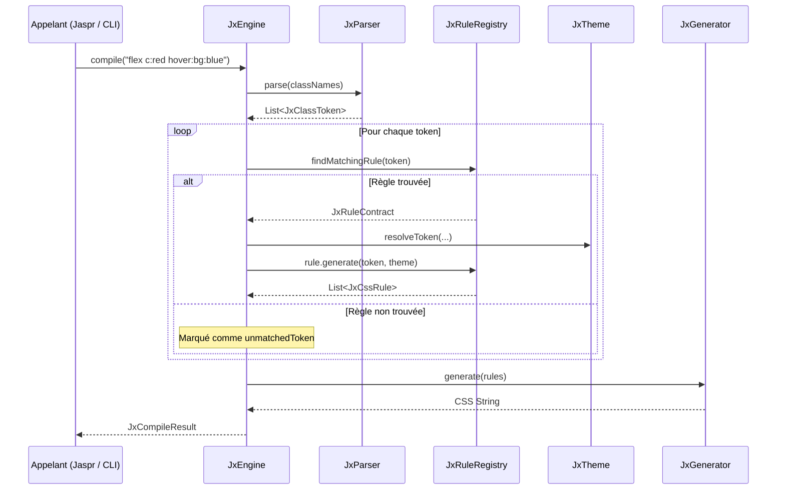

# Architecture Technique — JX CSS Framework

Ce document détaille l'architecture logicielle, les contrats d'interface, le cycle de compilation et les décisions de conception du framework CSS Utility-First propriétaire **JX CSS**.

---

## 1. Principes directeurs et vision

1. **100 % Dart natif** : Aucun wrapper Node.js, aucun recours à PostCSS ou Tailwind CSS. Le framework s'exécute directement dans la VM Dart, en ligne de commande ou intégré dans des projets Dart (Jaspr).
2. **Indépendance syntaxique** : Syntaxe de classes utility propriétaire distincte, extensible sans contrainte de rétrocompatibilité avec Tailwind.
3. **Architecture en couches découplées** : Chaque package a un périmètre de responsabilité strict, borné par des contrats d'interface (`abstract interface class`).
4. **Immuabilité des modèles** : Toutes les structures de données générées lors de la compilation (`JxCssDeclaration`, `JxCssRule`, `JxClassToken`, `JxCompileResult`) sont immuables.
5. **Prédictibilité et déterminisme** : Pour un même ensemble de classes et un même thème, l'ordre des règles générées et la feuille de style produite sont strictement déterministes.

---

## 2. Décomposition modulaire (Packages)

Le framework est scindé en 7 packages autonomes au sein d'un monorepo Melos :

```
                  ┌──────────────┐
                  │    jx_cli    │
                  └──────┬───────┘
                         │
                  ┌──────▼───────┐
                  │  jx_engine   │
                  └──────┬───────┘
         ┌───────────────┼───────────────┐
         │               │               │
  ┌──────▼───────┐ ┌─────▼───────┐ ┌─────▼───────┐
  │  jx_parser   │ │  jx_rules   │ │jx_generator │
  └──────┬───────┘ └─────┬───────┘ └─────┬───────┘
         │               │               │
         │         ┌─────▼───────┐       │
         │         │  jx_theme   │◄──────┘
         │         └─────┬───────┘
         │               │
         └───────┬───────┘
                 │
          ┌──────▼───────┐
          │   jx_core    │
          └──────────────┘
```

### 2.1 `jx_core` (Socle fondamental)
- **Rôle** : Fournit le vocabulaire commun et les contrats du système.
- **Contenus** :
  - **Modèles de données** :
    - `JxCssDeclaration` : modélise une paire propriété/valeur CSS avec drapeau `isImportant`.
    - `JxCssRule` : modélise une règle CSS complète avec sélecteur, déclarations, media query et pseudo-classe.
    - `JxClassToken` : résultat de l'analyse lexicale d'une classe (variantes, racine, valeur, importance).
    - `JxCompileResult` : résultat complet (CSS généré, règles, tokens appariés/ignorés, durée, avertissements).
    - `JxConfig` : options globales (préfixes, minification, inclusion de resets).
  - **Contrats d'interface** :
    - `JxParserContract`
    - `JxThemeContract`
    - `JxRuleContract`
    - `JxGeneratorContract`
    - `JxEngineContract`
  - **Exceptions** :
    - `JxException`, `JxParseException`, `JxRuleException`, `JxThemeException`, `JxConfigException`.

### 2.2 `jx_theme` (Tokens & Design System)
- **Rôle** : Gestion des tokens de design et conversion en variables CSS.
- **Contenus** :
  - `JxTokenValue` : unité atomique d'un token (catégorie, clé, valeur).
  - `JxThemeData` : collection indexée de tokens.
  - `JxTheme` (implémente `JxThemeContract`) : résout dynamiquement les valeurs associées aux tokens lors de l'application des règles et génère les variables CSS natives (`--jx-*`).

### 2.3 `jx_rules` (Définition des règles utilitaires)
- **Rôle** : Registre et logique de mise en correspondance des utilitaires CSS.
- **Contenus** :
  - `JxRule` (implémente `JxRuleContract`) : classe de base pour les règles utilitaires avec méthode `escapeSelector`.
  - `JxRuleRegistry` : registre permettant l'enregistrement, la détection et la suppression de règles dynamiques (base pour les futurs plugins et presets).

### 2.4 `jx_parser` (Analyse syntaxique des classes)
- **Rôle** : Analyse syntaxique des noms de classes.
- **Syntaxe propriétaire** :
  - Format canonique : `[variante1:variante2:...:]identifiant[:valeur][!]`
  - Exemples :
    - `flex` : identifiant `flex`, sans valeur ni variante.
    - `c:red` : identifiant `c`, valeur `red`.
    - `hover:bg:blue` : variante `hover`, identifiant `bg`, valeur `blue`.
    - `p:4!` : identifiant `p`, valeur `4`, important (`!important`).
- **Contenus** :
  - `JxParser` (implémente `JxParserContract`).

### 2.5 `jx_generator` (Génération & formatage CSS)
- **Rôle** : Transformation des arbres de règles en CSS textuel valide et optimisé.
- **Contenus** :
  - `JxGeneratorOptions` : contrôle la minification et l'indentation.
  - `JxGenerator` (implémente `JxGeneratorContract`) :
    - Sérialise les règles standard.
    - Regroupe automatiquement les règles conditionnées par des requêtes média `@media`.
    - Fournit `generateRootVariables` pour injecter le bloc `:root` des variables CSS du thème.

### 2.6 `jx_engine` (Orchestrateur de compilation)
- **Rôle** : Chef d'orchestre du pipeline de compilation.
- **Fonctionnement** :
  1. Reçoit une chaîne de classes ou des tokens.
  2. Invoque le `JxParserContract`.
  3. Pour chaque token, consulte le `JxRuleRegistry`.
  4. La règle correspondante génère les `JxCssRule` en résolvant les tokens de thème via `JxThemeContract`.
  5. Le `JxGeneratorContract` produit la feuille de style finale.
  6. Retourne un `JxCompileResult` immuable avec métriques de temps et alertes.

### 2.7 `jx_cli` (Interface en ligne de commande)
- **Rôle** : Point d'entrée utilisateur pour la compilation en mode autonome ou en scripts CI/CD.
- **Contenus** :
  - `bin/jx.dart` : point d'entrée exécutable.
  - `JxCliRunner` : analyseur d'options basé sur le package standard `args`.

---

## 3. Pipeline de compilation



---

## 4. Décisions architecturales majeures (ADR)

### ADR 01 : Adoption de Melos pour la gestion du Monorepo
- **Contexte** : Le framework est composé de plusieurs packages modulaires à cycles de vie distincts.
- **Décision** : Utiliser Melos pour orchestrer le bootstrap, les dépendances locales, l'analyse statique et les tests.
- **Conséquence** : Développement fluide, commandes unifiées et support multi-plateforme garanti (y compris Windows).

### ADR 02 : Typage strict et analyse statique unifiée
- **Contexte** : Éviter les régressions et garantir la solidité du compilateur.
- **Décision** : Configuration centralisée dans `analysis_options.yaml` à la racine avec `strict-casts: true`, `strict-inference: true` et `strict-raw-types: true`, réutilisée par tous les packages via `include: ../../analysis_options.yaml`.

### ADR 03 : Découplage strict via interfaces Dart (`abstract interface class`)
- **Contexte** : Permettre de remplacer le parseur, d'injecter des générateurs alternatifs ou de mockéiser les composants pour les tests.
- **Décision** : Définir des contrats dans `jx_core` sous forme d'`abstract interface class`.

### ADR 04 : Syntaxe propriétaire sans dépendance Tailwind
- **Contexte** : Maîtriser l'évolution du langage de classes et l'adapter aux particularités de Jaspr et du développement Dart.
- **Décision** : Syntaxe basée sur des segments séparés par deux-points (`identifiant[:valeur]`, modificateurs en préfixe et importance `!` en suffixe).

### ADR 05 : Pas d'implémentation prématurée des utilitaires CSS
- **Contexte** : La mission 01 porte sur l'initialisation de l'architecture, du monorepo et des contrats.
- **Décision** : Fournir l'ossature, les modèles, le registre et le parseur de base, sans implémenter prématurément le catalogue exhaustif des utilitaires CSS (qui fera l'objet des missions suivantes).

### ADR 06 : Variantes connues du parseur (mission 02)
- **Contexte** : `md:hidden` (variante + classe standalone) et `c:red` (identifiant + valeur) ont la même forme.
- **Décision** : Le parseur consomme en tête les segments appartenant à un ensemble de variantes connues. Le moteur lui transmet celles du `JxVariantResolver`, lui-même construit à partir des breakpoints du thème : ajouter un breakpoint au thème suffit à le rendre utilisable.

### ADR 07 : Variantes appliquées après génération (mission 02)
- **Contexte** : Les règles utilitaires ne doivent pas connaître les pseudo-classes ni les media queries.
- **Décision** : Une règle génère des `JxCssRule` « nues » ; le `JxVariantResolver` renseigne ensuite `pseudoSelector` et `mediaQuery`. Le moteur trie les règles de façon stable : sans media query d'abord, puis par breakpoint croissant (mobile-first).

### ADR 08 : Extraction des classes par littéraux de chaîne pour Dart (mission 03)
- **Contexte** : Un scan textuel brut d'un fichier Dart produit des faux positifs (`static` -> `position: static`, `hidden` dans un commentaire…).
- **Décision** : `JxClassExtractor.extractFromDart` ne lit que le contenu des littéraux de chaîne (simples, triples, bruts, interpolations imbriquées) et ignore les commentaires. Les autres fichiers (HTML…) utilisent un découpage générique. Les candidats sont filtrés par le parseur puis par le registre : un mot sans règle est ignoré silencieusement.

### ADR 09 : Preflight hors du modèle de règles utilitaires (mission 03)
- **Contexte** : La réinitialisation doit précéder tous les utilitaires sans fausser les métriques de compilation.
- **Décision** : `JxPreflight.rules` (dans `jx_generator`) est préfixé au CSS lorsque `JxConfig.includeReset` est actif, mais n'apparaît pas dans `JxCompileResult.rules`. Il fixe `border-style: solid` et `border-width: 0` afin que `bw:2` suffise à afficher une bordure.


### ADR 10 : Pseudo-éléments en fin de sélecteur (mission 05, formulaires)
- **Contexte** : Les champs de formulaire se stylent via des pseudo-éléments (`::placeholder`, `::file-selector-button`) qui, en CSS, doivent clore le sélecteur et ne peuvent pas être cumulés. Or l'ordre d'écriture des variantes JX est libre (`placeholder:focus:c:gray`).
- **Décision** : Le `JxVariantResolver` distingue `pseudoElements` de `pseudoClasses`. Les pseudo-classes sont concaténées dans l'ordre d'écriture, le pseudo-élément est toujours ajouté en dernier (`.…:focus::placeholder`). Combiner deux pseudo-éléments lève une `JxRuleException`, remontée en avertissement par le moteur. Les états de champs (`invalid`, `user-invalid`, `required`, `read-only`, `placeholder-shown`, `autofill`, `indeterminate`…) sont de simples pseudo-classes.

### ADR 11 : Anneau de focus par propriété personnalisée (mission 05, formulaires)
- **Contexte** : L'anneau de focus doit pouvoir changer de largeur et de couleur indépendamment, chacun avec ses propres variantes (`focus-visible:ring:2 ringc:blue`), alors qu'une `box-shadow` est une valeur unique.
- **Décision** : `ring:` génère `box-shadow: 0 0 0 <largeur> var(--jx-ring-color, currentColor)` et `ringc:` ne définit que `--jx-ring-color`. Conséquence assumée : `ring:` et `sh:` écrivent tous deux `box-shadow` et ne se cumulent pas sur un même élément.
